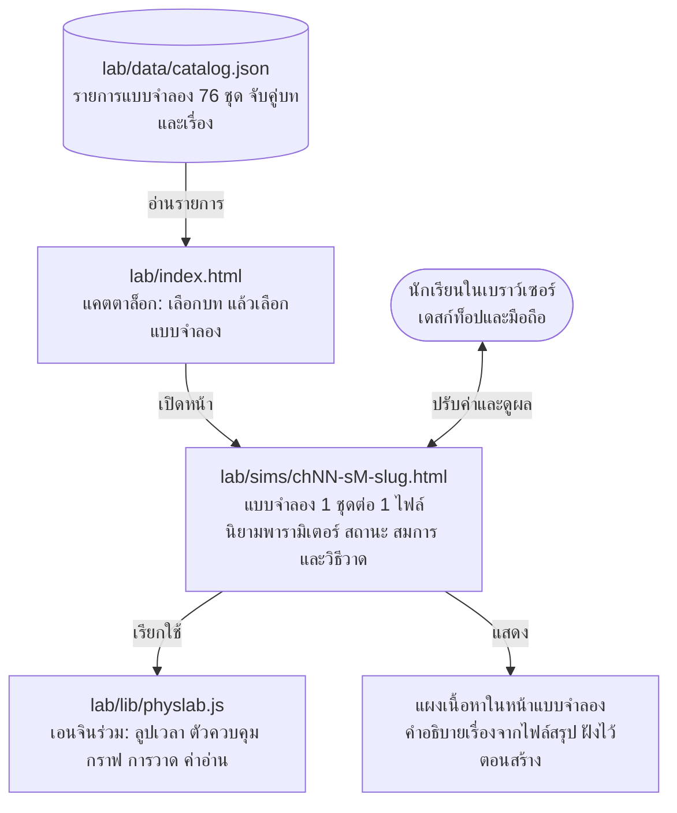

# Software Requirements Specification (SRS)
## Physics Lab — แบบจำลองฟิสิกส์เชิงโต้ตอบสำหรับนักเรียน (Interactive Physics Simulation) ด้วย HTML5 + JavaScript

| รายการ | ค่า |
|---|---|
| ชื่อระบบ | Physics Lab (โฟลเดอร์ `lab/` ในโปรเจกต์ cinematic-studio แต่ทำงานแยกจากระบบผลิตวิดีโอ) |
| เวอร์ชันเอกสาร | 0.2.0 |
| วันที่ | 2026-10-27 |
| สถานะ | ร่าง รอตรวจรับ |
| ผู้จัดทำ | Claude (ผู้พัฒนาและผู้ดำเนินการของโปรเจกต์) |
| ผู้ตรวจรับ | เจ้าของโปรเจกต์ |

---

## สารบัญ

1. บทนำ
2. ภาพรวมระบบ
3. ความต้องการเฉพาะ
4. ภาคผนวก

---

## 1. บทนำ

### 1.1 วัตถุประสงค์ของเอกสาร

เอกสารนี้กำหนดความต้องการของระบบ Physics Lab ซึ่งเป็นชุดแบบจำลองฟิสิกส์เชิงโต้ตอบที่เขียนด้วย HTML5 และ JavaScript ล้วน สำหรับให้นักเรียนใช้ทำความเข้าใจบทเรียนฟิสิกส์ ม.ปลาย ครบทั้ง 20 บท ใช้เป็นข้อตกลงร่วมระหว่างเจ้าของโปรเจกต์กับผู้พัฒนา ว่าระบบต้องทำอะไรได้บ้าง ทำได้ดีแค่ไหน และจะตรวจรับอย่างไร เอกสารนี้ไม่กำหนดวิธีเขียนโค้ดภายใน ซึ่งจะอยู่ในเอกสารออกแบบ (SDD) แยกต่างหาก

### 1.2 ขอบเขตของระบบ

Physics Lab คือกลุ่มหน้าเว็บที่แต่ละหน้าเป็นแบบจำลองฟิสิกส์หนึ่งชุด นักเรียนปรับค่าตัวแปรผ่านแถบเลื่อน แล้วเห็นผลเป็นภาพเคลื่อนไหวบน canvas พร้อมกราฟ ค่าตัวเลข และสูตรที่คำนวณจริงแบบเฟรมต่อเฟรม

ระบบครอบคลุม

- หน้าแคตตาล็อกรวมแบบจำลองทั้งหมด แยกตามบทเรียน 20 บท
- เอนจินร่วมที่ทุกแบบจำลองใช้ (ลูปเวลา ตัวควบคุม กราฟ การวาด ค่าอ่าน)
- แบบจำลอง 76 ชุด ครอบคลุมเนื้อหาครบ 195 เรื่องของแผ่นสรุป 20 บท (รายการในภาคผนวก 4.1)
- ชุดทดสอบความถูกต้องของฟิสิกส์และการเปิดใช้งาน

ระบบไม่ครอบคลุม

- ระบบหลังบ้าน บัญชีผู้ใช้ การเก็บคะแนน หรือการส่งข้อมูลขึ้นเซิร์ฟเวอร์
- แบบฝึกหัดและการตรวจคำตอบ
- การเชื่อมต่อกับระบบผลิตวิดีโอ cinematic-studio ทุกรูปแบบ (โหมดวิดีโอ การอัดเฟรม การส่งออกคลิป) ส่วนนี้ตกลงกันว่าเป็นส่วนขยายในอนาคต จะเพิ่มเป็นโมดูลแยกเมื่อเจ้าของโปรเจกต์สั่ง ดูภาคผนวก 4.4
- ฟิสิกส์นอกหลักสูตร ม.ปลาย

เนื้อหาต้นทางของทุกแบบจำลองคือแผ่นสรุป 20 บทที่สกัดไว้ในไฟล์ `physics-summary-20-chapters-content.md` และฉบับอธิบายง่ายใน `physics-summary-20-chapters-easy.md` ซึ่งใช้เป็นรหัสอ้างอิงเลขบทและเลขเรื่อง

### 1.3 นิยาม คำย่อ และศัพท์เฉพาะ

| คำ | ความหมาย |
|---|---|
| แบบจำลอง (Simulation, sim) | หน้าเว็บหนึ่งหน้าที่จำลองปรากฏการณ์ฟิสิกส์หนึ่งชุด มีรหัสเช่น S7.1 (บท 7 ชุดที่ 1) |
| เรื่อง (Topic) | หัวข้อย่อยในบทเรียน อ้างอิงเลขบทและเลขเรื่องตามไฟล์สรุปฉบับเข้าใจง่าย เช่น บท 7 เรื่อง 3 |
| พารามิเตอร์ (Parameter) | ค่าที่นักเรียนปรับได้ เช่น มวล ความเร็วต้น มุม |
| สถานะ (State) | ค่าที่เปลี่ยนไปตามเวลาระหว่างจำลอง เช่น ตำแหน่ง ความเร็ว |
| ก้าวเวลา (Time step, dt) | ช่วงเวลาที่เอนจินคำนวณฟิสิกส์หนึ่งครั้ง |
| ค่าอ่าน (Readout) | ตัวเลขที่แสดงสด ๆ ระหว่างจำลอง พร้อมหน่วย |
| ชุดค่าสำเร็จรูป (Preset) | ปุ่มที่ตั้งค่าพารามิเตอร์หลายตัวพร้อมกันเป็นกรณีที่น่าสนใจ |
| แผงอ้างอิง | ส่วนแสดงเนื้อหาที่เป็นนิยามหรือตารางข้อมูล ซึ่งไม่ได้จำลอง แต่แสดงประกอบในแบบจำลองที่เกี่ยวข้อง |
| FR / NFR | ความต้องการเชิงฟังก์ชัน / ความต้องการที่ไม่ใช่ฟังก์ชัน |
| ลำดับความสำคัญ M / S / C | ต้องมี (Must) / ควรมี (Should) / อาจมี (Could) |
| canvas | องค์ประกอบ HTML5 สำหรับวาดภาพด้วย JavaScript |
| rAF | `requestAnimationFrame` กลไกวนลูปวาดภาพของเบราว์เซอร์ |

### 1.4 เอกสารอ้างอิง

| รหัส | เอกสาร |
|---|---|
| REF-1 | `Physics Summary 20 Chapters.pdf` (Physics Blueprint Map) ต้นฉบับเนื้อหา |
| REF-2 | `physics-summary-20-chapters-content.md` เนื้อหาและสูตรที่สกัดจาก REF-1 |
| REF-3 | `physics-summary-20-chapters-easy.md` สรุปรายเรื่อง 195 เรื่อง ใช้เป็นรหัสอ้างอิงเรื่อง |
| REF-4 | แคนวาสออกแบบหน้าจอ Physics Lab UI Design: https://claude.ai/artifact/3VwHxBCwwNSrUqix5qhFDe ประกอบด้วยหน้าแคตตาล็อก หน้าแบบจำลอง (เดสก์ท็อปและมือถือ) การ์ดออกแบบของแบบจำลองทั้ง 76 ชุดแยกรายบท และหน้าจอเต็มของทุกชุด S1.1 ถึง S20.5 (แถวล่างของแคนวาส) |
| REF-5 | `docs/04-implementation/Developer-Guide.md` แนวทางพัฒนาของโปรเจกต์ (ใช้เฉพาะมาตรฐานการเขียนโค้ดและการทดสอบ) |

### 1.5 ภาพรวมของเอกสาร

ส่วนที่ 2 อธิบายภาพรวมระบบ ผู้ใช้ สภาพแวดล้อม และข้อจำกัด ส่วนที่ 3 ระบุความต้องการทีละข้อพร้อมรหัสและลำดับความสำคัญ ส่วนที่ 4 เป็นภาคผนวก ได้แก่ รายการแบบจำลองทั้ง 76 ชุด เกณฑ์ตรวจรับ โครงสร้างไดเรกทอรี และส่วนขยายในอนาคต

---

## 2. ภาพรวมระบบ

### 2.1 มุมมองผลิตภัณฑ์

Physics Lab เป็นระบบอิสระในโฟลเดอร์ `lab/` ไม่พึ่งพาและไม่ถูกเรียกใช้โดยระบบผลิตวิดีโอ cinematic-studio ที่อยู่ในโปรเจกต์เดียวกัน ทั้งสองระบบแก้ไขแยกกันได้โดยไม่กระทบกัน



หลักการออกแบบระดับความต้องการ

- หนึ่งแบบจำลอง = หนึ่งไฟล์ HTML เปิดได้ทันที ไม่มีขั้นตอน build
- โค้ดร่วมอยู่ในไลบรารีเดียว แบบจำลองแต่ละชุดเขียนเฉพาะส่วนที่เป็นฟิสิกส์ของเรื่องนั้น
- ฟิสิกส์คำนวณจริงทุกเฟรมจากสมการใน REF-2 ไม่ใช่แอนิเมชันที่วาดไว้ล่วงหน้า และไม่ใช้ไฟล์ภาพ ทุกอย่างวาดด้วยโค้ด
- ผลลัพธ์ต้องทำซ้ำได้ ค่าพารามิเตอร์เดียวกันให้ภาพเดียวกันทุกครั้งทุกเครื่อง
- ทุกแบบจำลองมีหน้าตาและวิธีใช้แบบเดียวกันตาม REF-4 นักเรียนเรียนรู้วิธีใช้ครั้งเดียวแล้วใช้ได้ทุกเรื่อง

### 2.2 ฟังก์ชันหลักของระบบ

| ลำดับ | ฟังก์ชัน |
|---|---|
| F1 | แสดงแคตตาล็อกแบบจำลองแยกตามบท ค้นหาและเปิดได้ |
| F2 | จำลองปรากฏการณ์ด้วยสมการฟิสิกส์แบบก้าวเวลาคงที่ เล่น หยุด ก้าวทีละเฟรม รีเซ็ต ปรับความเร็ว |
| F3 | ปรับพารามิเตอร์ด้วยแถบเลื่อน ช่องตัวเลข ปุ่มเลือก และการลากบนภาพ เห็นผลทันที |
| F4 | วาดภาพบน canvas พร้อมลูกศรเวกเตอร์ รอยทาง แกน และตาราง |
| F5 | กราฟเรียลไทม์ของปริมาณที่เลือก |
| F6 | ค่าอ่านสดพร้อมหน่วย และสูตรที่แทนค่าแล้ว |
| F7 | แสดงคำอธิบายเรื่องนั้นจาก REF-3 และหัวข้อ "ลองทำดู" ข้างแบบจำลอง |
| F8 | บันทึกภาพนิ่งและคัดลอกลิงก์ที่ฝังค่าพารามิเตอร์ เพื่อแบ่งปันกรณีที่ตั้งไว้ |

### 2.3 ลักษณะผู้ใช้

| ผู้ใช้ | ลักษณะ | สิ่งที่ต้องการ |
|---|---|---|
| นักเรียน ม.ปลาย และผู้สนใจทั่วไป | ไม่มีพื้นฐานเขียนโปรแกรม ใช้มือถือเป็นหลัก | เปิดแล้วเล่นได้ทันที ภาษาไทย ปุ่มใหญ่ ไม่ต้องอ่านคู่มือ เห็นสูตรเชื่อมกับภาพ |
| ผู้สอนและเจ้าของโปรเจกต์ | ใช้ประกอบการสอนและตรวจความถูกต้อง | ตั้งค่ากรณีที่ต้องการแล้วแชร์เป็นลิงก์ได้ เห็นสูตรและค่าที่ใช้ชัดเจน ตรวจเทียบกับแผ่นสรุปได้ |
| ผู้พัฒนา (Claude) | เพิ่มแบบจำลองใหม่เรื่อย ๆ จนครบ 76 ชุด | โครงสร้างเดียวกันทุกไฟล์ เพิ่มชุดใหม่ได้โดยเขียนเฉพาะฟิสิกส์ |

### 2.4 สภาพแวดล้อมการทำงาน

| ด้าน | ข้อกำหนด |
|---|---|
| เบราว์เซอร์ | Chrome, Safari, Firefox, Edge สองรุ่นล่าสุด ทั้งเดสก์ท็อปและมือถือ |
| การเปิดใช้ | เปิดจากไฟล์โดยตรง (`file://`) ได้ และเปิดผ่านเซิร์ฟเวอร์สถิตใดก็ได้ |
| เครือข่าย | ไม่ต้องต่ออินเทอร์เน็ตขณะใช้งาน |
| เครื่องมือพัฒนา | Node.js 20 ขึ้นไป ใช้เฉพาะรันชุดทดสอบ ไม่ใช้ตอนรันแบบจำลอง |
| ขนาดหน้าจอ | ตั้งแต่ 360 px (มือถือแนวตั้ง) ถึง 2560 px |
| เสียง | แบบจำลองบท 12 (เสียง) ใช้ Web Audio API ของเบราว์เซอร์สร้างเสียง ไม่ใช้ไฟล์เสียง |

### 2.5 ข้อจำกัดในการออกแบบและการนำไปใช้

| รหัส | ข้อจำกัด |
|---|---|
| CON-1 | ใช้ HTML5, CSS, JavaScript (ES2022) ล้วน ไม่ใช้เฟรมเวิร์ก ไม่ใช้ bundler ไม่มีขั้นตอน build |
| CON-2 | ไม่โหลดสคริปต์ ฟอนต์ หรือภาพจากอินเทอร์เน็ตขณะรัน ทุกอย่างอยู่ในโฟลเดอร์ `lab/` |
| CON-3 | ไลบรารีร่วมโหลดแบบสคริปต์ธรรมดา (classic script) เพื่อให้เปิดจาก `file://` ได้ ไม่ใช้ ES module import ในหน้าแบบจำลอง |
| CON-4 | ข้อความบนหน้าจอเป็นภาษาไทย หน่วยเป็น SI ห้ามใช้อักขระ Unicode แบบซ้อน (combining characters) ในข้อความ เพราะฟอนต์บางตัวแสดงผลเพี้ยน ลูกศรเวกเตอร์และขีดบนให้วาดด้วย canvas แทน |
| CON-5 | สูตรและค่าคงตัวต้องตรงกับ REF-2 ถ้าจำเป็นต้องใช้สูตรนอกเหนือจากนั้น (เช่น แรงต้านอากาศ ความหน่วง) ต้องระบุในหน้าแบบจำลองว่าเป็นส่วนขยาย และปิดเป็นค่าเริ่มต้น |
| CON-6 | ไม่ใช้ไฟล์ภาพ (png, jpg, svg แยกไฟล์) ภาพทั้งหมดวาดด้วย canvas หรือ SVG ในโค้ด |
| CON-7 | แต่ละไฟล์แบบจำลองไม่เกิน 300 KB และไลบรารีร่วมไม่เกิน 200 KB |
| CON-8 | ฟิสิกส์คำนวณด้วยก้าวเวลาคงที่ แยกจากอัตราเฟรมของจอ เพื่อให้ผลไม่ขึ้นกับความเร็วเครื่อง |
| CON-9 | ไม่มีโค้ดส่วนใดอ้างถึงหรือเรียกใช้สคริปต์ของระบบผลิตวิดีโอ cinematic-studio |

### 2.6 สมมติฐานและการพึ่งพา

| รหัส | รายการ |
|---|---|
| ASM-1 | เนื้อหาต้นทางคือ REF-2 และ REF-3 ซึ่งถือว่าถูกต้องตามหลักสูตร ม.ปลาย หากพบข้อผิดพลาดในต้นฉบับ ให้บันทึกไว้ใน Known Issues และใช้ค่าที่ถูกต้องตามหลักฟิสิกส์ |
| ASM-2 | ค่า g เริ่มต้น 9.8 m/s² นักเรียนเปลี่ยนได้ในแบบจำลองที่เกี่ยวข้อง |
| ASM-3 | ไม่คิดแรงต้านอากาศและความเสียดทานเว้นแต่แบบจำลองนั้นระบุเป็นพารามิเตอร์ |
| ASM-4 | การ์ดออกแบบใน REF-4 คือข้อกำหนดระดับหน้าจอของแต่ละแบบจำลอง (ภาพกลางจอ ปรับได้ เห็นผล กราฟ) เอกสารนี้ไม่คัดลอกซ้ำทุกชุด แต่ระบุสเปกละเอียดของชุดตัวอย่าง 5 ชุดไว้ในหัวข้อ 3.2.8 เป็นมาตรฐานความละเอียด |
| DEP-1 | ชุดทดสอบใช้ Playwright ซึ่งโปรเจกต์มีอยู่แล้ว เฉพาะตอนทดสอบเท่านั้น |

---

## 3. ความต้องการเฉพาะ

### 3.1 ส่วนต่อประสานภายนอก

#### 3.1.1 ส่วนต่อประสานผู้ใช้ (User Interfaces)

หน้าจอมี 2 แบบตาม REF-4 คือ หน้าแคตตาล็อก และหน้าแบบจำลอง (มีเลย์เอาต์เดสก์ท็อปและมือถือ)

| รหัส | ความต้องการ | ลำดับ |
|---|---|---|
| UI-01 | หน้าแบบจำลองแบ่งเป็น 5 ส่วน ได้แก่ พื้นที่ภาพ (canvas) แถบควบคุมการเล่น แผงพารามิเตอร์ แผงค่าอ่านและสูตร แผงกราฟ และแผงเนื้อหา | M |
| UI-02 | จอกว้างตั้งแต่ 1024 px วางภาพซ้าย แผงพารามิเตอร์และค่าอ่านขวา จอแคบกว่า 768 px วางซ้อนกันแนวตั้ง ภาพอยู่บนสุด ตามด้วยแถบควบคุม พารามิเตอร์ ค่าอ่าน กราฟ และเนื้อหา | M |
| UI-03 | ปุ่มหลักมี เล่น/หยุด ก้าวทีละเฟรม รีเซ็ต และตัวเลือกความเร็ว 0.25x 0.5x 1x 2x 4x | M |
| UI-04 | แป้นพิมพ์ลัด: เว้นวรรค = เล่น/หยุด, R = รีเซ็ต, ลูกศรขวา = ก้าวหนึ่งเฟรม | S |
| UI-05 | จุดสัมผัสบนมือถือมีขนาดอย่างน้อย 44 × 44 px | M |
| UI-06 | ทุกข้อความเป็นภาษาไทย ชื่อตัวแปรใช้สัญลักษณ์สากล (u, v, a, θ) พร้อมหน่วย | M |
| UI-07 | แผงเนื้อหาแสดงชื่อบท ชื่อเรื่อง คำอธิบายจาก REF-3 และหัวข้อ "ลองทำดู" อย่างน้อย 2 ข้อที่ชวนให้ปรับค่าแล้วสังเกตผล | M |
| UI-08 | ทุกแบบจำลองมีปุ่ม "ค่าเริ่มต้น" และชุดค่าสำเร็จรูปอย่างน้อย 2 ชุดที่แสดงกรณีน่าสนใจของเรื่องนั้น ตามที่ระบุในการ์ดของ REF-4 | M |
| UI-09 | ส่วนหัวของหน้าแบบจำลองมีปุ่มกลับไปแคตตาล็อก ชื่อบทและเลขเรื่องที่ครอบคลุม ปุ่มค่าเริ่มต้น คัดลอกลิงก์ และบันทึกภาพ | M |
| UI-10 | ธีมสว่างและมืดตามการตั้งค่าของระบบ พื้นหลังของ canvas ต้องอ่านได้ทั้งสองธีม | S |
| UI-11 | เคารพการตั้งค่า "ลดการเคลื่อนไหว" ของระบบ โดยไม่เล่นอัตโนมัติเมื่อเปิดหน้า | C |
| UI-12 | สีสื่อความหมายเดียวกันทุกแบบจำลอง: น้ำเงิน = วัตถุหรือปริมาณหลัก, ส้ม = ความเร็วแนวนอนหรือแรงที่ผู้ใช้ใส่, เขียว = ความเร็วแนวดิ่งหรือแรงปฏิกิริยา, แดง = น้ำหนักหรือประจุบวก | S |

#### 3.1.2 ส่วนต่อประสานไฟล์ (File Interfaces)

| รหัส | ความต้องการ | ลำดับ |
|---|---|---|
| FI-01 | `lab/data/catalog.json` เก็บรายการแบบจำลอง แต่ละรายการมี `id` (เช่น `S7.1`), `chapter`, `topics` (รายการเลขเรื่อง), `title`, `file`, `summary`, `tags`, `status` (`planned` / `draft` / `ready`) | M |
| FI-02 | ไฟล์แบบจำลองชื่อตามรูปแบบ `chNN-sM-<slug>.html` เช่น `ch07-s1-projectile.html` | M |
| FI-03 | พารามิเตอร์ตั้งต้นรับจาก URL query ได้ทุกตัว เช่น `?u=20&theta=45` ค่าที่ไม่ส่งมาใช้ค่าเริ่มต้น ค่าที่เกินช่วงให้ปัดเข้าช่วงที่กำหนด | M |
| FI-04 | ปุ่ม "คัดลอกลิงก์" สร้าง URL ที่ฝังค่าพารามิเตอร์ปัจจุบันทั้งหมด เปิดแล้วได้สถานะเดียวกัน ใช้สำหรับผู้สอนส่งกรณีให้นักเรียน | S |
| FI-05 | ปุ่ม "บันทึกภาพ" ส่งออกภาพนิ่ง PNG ของพื้นที่ canvas ที่ความละเอียดอย่างน้อย 1920 × 1080 | S |

#### 3.1.3 ส่วนต่อประสานซอฟต์แวร์ (Software Interfaces)

| รหัส | ความต้องการ | ลำดับ |
|---|---|---|
| SI-01 | ไลบรารีร่วม `lab/lib/physlab.js` เปิดเผย API ผ่านตัวแปรเดียว `window.PhysLab` ประกอบด้วย `createSim(config)`, `controls`, `graph`, `draw`, `units`, `audio` (สำหรับบท 12) | M |
| SI-02 | แบบจำลองนิยามด้วย config object ที่มีอย่างน้อย `id`, `chapter`, `topics`, `params` (ช่วง ค่าเริ่มต้น หน่วย), `presets`, `init(params)`, `step(state, params, dt)`, `draw(ctx, state, params)`, `readouts(state, params)`, `formulas(state, params)`, `graphs` | M |
| SI-03 | เซิร์ฟเวอร์พรีวิวเดิมของโปรเจกต์อาจเสิร์ฟ `/lab/` ได้เพื่อความสะดวก แต่ Physics Lab ต้องไม่พึ่งพาเซิร์ฟเวอร์นั้น | C |

#### 3.1.4 ส่วนต่อประสานการสื่อสาร

ไม่มี ระบบไม่ส่งหรือรับข้อมูลผ่านเครือข่ายขณะทำงาน

### 3.2 ความต้องการเชิงฟังก์ชัน

#### 3.2.1 CAT — แคตตาล็อกแบบจำลอง

| รหัส | ความต้องการ | ลำดับ |
|---|---|---|
| CAT-01 | `lab/index.html` อ่าน `catalog.json` แล้วแสดงแบบจำลองจัดกลุ่มตามบท 1 ถึง 20 เรียงตามรหัส | M |
| CAT-02 | แต่ละรายการแสดงชื่อ บท เรื่องที่ครอบคลุม ภาพร่างเล็ก คำอธิบายหนึ่งบรรทัด สถานะ และปุ่มเปิด รายการสถานะ `planned` แสดงแบบจางและเปิดไม่ได้ | M |
| CAT-03 | กรองตามระดับชั้น (ม.4 บท 1 ถึง 7, ม.5 บท 8 ถึง 13, ม.6 บท 14 ถึง 20) และกรองเฉพาะที่พร้อมใช้ | M |
| CAT-04 | ค้นหาด้วยข้อความจากชื่อ แท็ก และชื่อเรื่อง ผลกรองทันทีขณะพิมพ์ | S |
| CAT-05 | แสดงความคืบหน้าว่าแต่ละบทมีแบบจำลองพร้อมใช้กี่ชุดจากทั้งหมด และรวมทั้งระบบกี่ชุดจาก 76 | S |

#### 3.2.2 ENG — เอนจินจำลอง

| รหัส | ความต้องการ | ลำดับ |
|---|---|---|
| ENG-01 | คำนวณฟิสิกส์ด้วยก้าวเวลาคงที่ค่าเริ่มต้น dt = 1/120 s ใช้ตัวสะสมเวลา (accumulator) แยกจาก rAF เพื่อให้ผลเท่ากันทุกเครื่อง | M |
| ENG-02 | ตัวอินทิเกรตเริ่มต้นเป็น semi-implicit Euler และเลือก RK4 ได้ต่อแบบจำลองสำหรับระบบที่ต้องการความแม่นสูง เช่น วงโคจร | M |
| ENG-03 | รองรับ เล่น หยุด ก้าวทีละ dt รีเซ็ตกลับสถานะเริ่มต้น และตัวคูณความเร็ว 0.25 ถึง 4 เท่าโดยไม่เปลี่ยน dt | M |
| ENG-04 | เปลี่ยนพารามิเตอร์ระหว่างเล่นได้ แบบจำลองกำหนดได้ว่าพารามิเตอร์ใดมีผลทันทีและพารามิเตอร์ใดต้องรีเซ็ตก่อน | M |
| ENG-05 | ผลลัพธ์ต้องกำหนดได้ (deterministic): พารามิเตอร์ชุดเดียวกันและจำนวนก้าวเท่ากันให้สถานะเท่ากันทุกบิต แบบจำลองที่ใช้ค่าสุ่ม (เช่น การสลายตัว ทฤษฎีจลน์) ต้องรับ seed | M |
| ENG-06 | ตรวจจับค่า NaN หรือ Infinity ในสถานะ แล้วหยุดพร้อมแจ้งเตือน ไม่ปล่อยให้ภาพค้างหรือว่างเปล่า | M |
| ENG-07 | เมื่อแท็บถูกซ่อน ให้หยุดลูปและกลับมาเล่นต่อโดยไม่กระโดดข้ามเวลา | S |
| ENG-08 | แบบจำลองสถิต (ไม่มีการเปลี่ยนตามเวลา เช่น เลนส์ เวกเตอร์ ลามี) ใช้เอนจินเดียวกันแต่ซ่อนแถบเล่นและคำนวณใหม่ทันทีเมื่อพารามิเตอร์เปลี่ยน | M |

#### 3.2.3 CTL — ตัวควบคุมพารามิเตอร์

| รหัส | ความต้องการ | ลำดับ |
|---|---|---|
| CTL-01 | พารามิเตอร์แต่ละตัวมีแถบเลื่อนคู่กับช่องตัวเลข ระบุ ชื่อ สัญลักษณ์ หน่วย ค่าต่ำสุด สูงสุด ขั้น และค่าเริ่มต้น | M |
| CTL-02 | พารามิเตอร์แบบตัวเลือก (เช่น ชนิดเลนส์ ชนิดการชน ค่า g ของดาว) แสดงเป็นปุ่มสลับหรือเมนู | M |
| CTL-03 | ค่าที่พิมพ์เกินช่วงให้ปัดเข้าช่วงและแสดงค่าที่ใช้จริง | M |
| CTL-04 | ชุดค่าสำเร็จรูปตั้งค่าหลายพารามิเตอร์พร้อมกันในคลิกเดียว และระบุชื่อกรณี เช่น "มุม 30° กับ 60° ตกไกลเท่ากัน" | M |
| CTL-05 | พารามิเตอร์ที่การ์ดใน REF-4 ระบุว่า "ลากได้" ต้องปรับได้โดยลากบนภาพโดยตรง เช่น ลากวัตถุหน้าเลนส์ ลากปลายเวกเตอร์ ลากน้ำหนักบนคาน | M |
| CTL-06 | ล็อกพารามิเตอร์ให้คงที่ได้ในแบบจำลองที่ต้องการ (เช่น กฎของแก๊ส ล็อก T แล้วปรับ V ดู P) | S |

#### 3.2.4 VIS — การแสดงผลบน canvas

| รหัส | ความต้องการ | ลำดับ |
|---|---|---|
| VIS-01 | ใช้ระบบพิกัดโลก (หน่วยเมตร) แปลงเป็นพิกเซลผ่านไลบรารีร่วม แบบจำลองไม่ต้องคำนวณพิกเซลเอง | M |
| VIS-02 | รองรับจอความละเอียดสูง (devicePixelRatio) ภาพคม ไม่เบลอ | M |
| VIS-03 | เปิดปิดการแสดง ลูกศรความเร็ว ลูกศรแรง รอยทาง ตาราง และแกน ได้แยกกัน | S |
| VIS-04 | ลูกศรเวกเตอร์มีความยาวแปรตามขนาด มีป้ายชื่อและค่าติดปลายลูกศร | M |
| VIS-05 | ภาพต้องพอดีกรอบเสมอ เมื่อค่าพารามิเตอร์ทำให้วัตถุออกนอกกรอบ ให้ปรับมาตราส่วนอัตโนมัติหรือเลื่อนกล้องตาม ตามที่แบบจำลองกำหนด | M |
| VIS-06 | สีและเส้นมีความต่างสี (contrast) เพียงพอทั้งธีมสว่างและมืด และไม่พึ่งสีอย่างเดียวในการแยกความหมาย (ใช้รูปร่างหรือป้ายร่วม) | S |
| VIS-07 | แบบจำลองที่มีหลายกรณีซ้อนกัน (เช่น วิถี 30° กับ 60°, วงโคจรหลายวง, ฮาร์มอนิก 1 ถึง 4) วาดซ้อนกันได้โดยใช้สีหรือความโปร่งใสแยกกรณี | S |

#### 3.2.5 GRP — กราฟเรียลไทม์

| รหัส | ความต้องการ | ลำดับ |
|---|---|---|
| GRP-01 | แสดงกราฟอนุกรมเวลาของปริมาณที่แบบจำลองกำหนดได้สูงสุด 3 เส้นต่อกราฟ และสูงสุด 3 กราฟต่อหน้า | M |
| GRP-02 | แกนปรับมาตราส่วนอัตโนมัติ มีป้ายชื่อแกนพร้อมหน่วย และคำอธิบายสี | M |
| GRP-03 | หน้าต่างเวลาเริ่มต้น 10 วินาที เลื่อนตามเมื่อเวลาเกิน ผู้ใช้เปลี่ยนเป็น 5, 10, 30, 60 วินาทีได้ | S |
| GRP-04 | กราฟแบบไม่ใช่เวลา (เช่น P-V, σ-ε, T²-R³, I-V) รองรับโดยกำหนดปริมาณบนแกนนอนได้ | M |
| GRP-05 | ชี้บนกราฟแล้วเห็นค่าที่จุดนั้น และในกราฟ s-t, v-t, F-S, F-t แสดงความชันหรือพื้นที่ใต้กราฟของช่วงที่เลือกได้ | S |

#### 3.2.6 RDO — ค่าอ่านและสูตร

| รหัส | ความต้องการ | ลำดับ |
|---|---|---|
| RDO-01 | แสดงค่าปริมาณสำคัญสด ๆ พร้อมหน่วย ปัดเป็นเลขนัยสำคัญ 3 ตัวโดยปริยาย | M |
| RDO-02 | แสดงสูตรหลักของเรื่องนั้นในรูปสัญลักษณ์ และบรรทัดถัดไปเป็นสูตรที่แทนค่าปัจจุบันแล้วพร้อมผลลัพธ์ เช่น `Sx max = u² sin2θ / g = (20)² sin(90°) / 9.8 = 40.8 m` | M |
| RDO-03 | ค่าที่ได้จากสมการเชิงวิเคราะห์กับค่าที่ได้จากการจำลองแสดงคู่กันเมื่อเรื่องนั้นมีคำตอบเชิงวิเคราะห์ เพื่อให้ผู้เรียนเห็นว่าตรงกัน | S |
| RDO-04 | ปริมาณที่อนุรักษ์ (โมเมนตัม พลังงาน ประจุ) แสดงเป็นแถบเทียบก่อนหลังหรือแถบสะสม | M |

#### 3.2.7 INF — เนื้อหาประกอบ

| รหัส | ความต้องการ | ลำดับ |
|---|---|---|
| INF-01 | แต่ละแบบจำลองระบุเลขบทและเลขเรื่องตาม REF-3 ที่ครอบคลุม ตรงกับตารางในภาคผนวก 4.1 | M |
| INF-02 | แผงเนื้อหาแสดงคำอธิบายของเรื่องเหล่านั้นจาก REF-3 แบบคงที่ (ฝังไว้ในไฟล์แบบจำลองตอนสร้าง ไม่โหลดไฟล์ Markdown ขณะรัน) | M |
| INF-03 | เรื่องที่เป็นนิยาม ตารางข้อมูล หรือประวัติ (เช่น หน่วยฐาน 7 ตัว ประวัติแม็กซ์เวลล์ รายชื่อเลปตอน) แสดงเป็นแผงอ้างอิงในแบบจำลองที่เกี่ยวข้องตามที่ระบุในภาคผนวก 4.1 เพื่อให้ครบ 195 เรื่อง | M |
| INF-04 | มีหัวข้อ "ลองทำดู" อย่างน้อย 2 ข้อต่อแบบจำลอง | M |

#### 3.2.8 SIM — แบบจำลอง

ต้องมีแบบจำลองครบ 76 ชุดตามภาคผนวก 4.1 แต่ละชุดต้องเป็นไปตามข้อกำหนดร่วมใน 3.2.2 ถึง 3.2.7 และตรงกับการ์ดออกแบบใน REF-4 (ภาพกลางจอ สิ่งที่ปรับได้ ค่าที่เห็น กราฟ) ด้านล่างคือสเปกละเอียดของชุดตัวอย่าง 5 ชุด ใช้เป็นมาตรฐานความละเอียดที่ทุกชุดต้องมีในเอกสารออกแบบ

**S7.1 โพรเจกไทล์** (บท 7 เรื่อง 1 ถึง 3)

| หัวข้อ | ข้อกำหนด |
|---|---|
| พารามิเตอร์ | ความเร็วต้น u 0 ถึง 50 m/s, มุมยิง θ 0 ถึง 90°, ความสูงปล่อย h₀ 0 ถึง 50 m, ค่า g เลือกได้ (ดวงจันทร์ 1.6, ดาวอังคาร 3.7, โลก 9.8, ดาวพฤหัส 24.8) |
| สถานะ | ตำแหน่ง (x, y), ความเร็ว (vx, vy), เวลา t |
| ภาพ | วิถีโค้ง จุดปัจจุบัน ลูกศร vx, vy และ v รวม จุดสูงสุด จุดตก เส้นพื้น |
| ค่าอ่าน | t, x, y, vx, vy, v, เวลาถึงจุดสูงสุด, ความสูงสูงสุด, ระยะตก, เวลารวม |
| สูตรแสดง | ux = u cosθ, uy = u sinθ, sy = uy t − ½gt², Sx max = u² sin2θ / g |
| กราฟ | y-t และ vy-t |
| ชุดค่าสำเร็จรูป | "45° ไกลสุด", "30° กับ 60° ตกไกลเท่ากัน" (วาดสองวิถีซ้อนกัน), "ปล่อยจากที่สูง" |
| เกณฑ์ความแม่น | ระยะตกและเวลาจากการจำลองต่างจากสูตรไม่เกิน 0.5% ที่ dt = 1/120 s |

**S8.1 SHM ของมวลติดสปริง** (บท 8 เรื่อง 1 ถึง 5)

| หัวข้อ | ข้อกำหนด |
|---|---|
| พารามิเตอร์ | มวล m 0.1 ถึง 5 kg, ค่าคงตัวสปริง k 1 ถึง 200 N/m, แอมพลิจูด A 0.05 ถึง 1 m (ลากได้), จุดเริ่ม (ที่ A หรือที่สมดุล), ความหน่วง 0 ถึง 1 (ค่าเริ่มต้น 0 ระบุเป็นส่วนขยาย) |
| สถานะ | x, v, a, t |
| ภาพ | สปริงกับมวลบนพื้น เส้นจุดสมดุลและขอบ ±A ลูกศร v และ a แถบพลังงาน Ek กับ Ep |
| ค่าอ่าน | x, v, a, ω, T, f, v_max, a_max, Ek, Ep, E รวม |
| สูตรแสดง | ω = √(k/m), T = 2π√(m/k), v = ω√(A² − x²), a = −ω²x |
| กราฟ | x-t, v-t, a-t ซ้อนกันในกราฟเดียว และ Ek/Ep-t |
| ชุดค่าสำเร็จรูป | "สปริงแข็ง", "มวลหนัก", "เริ่มที่จุดสมดุล" |
| เกณฑ์ความแม่น | คาบจากการจำลองต่างจาก 2π√(m/k) ไม่เกิน 0.5% และพลังงานรวม (ไม่มีความหน่วง) เปลี่ยนไม่เกิน 0.1% ใน 60 s |

**S6.2 การชน 1 มิติ** (บท 6 เรื่อง 4, 5)

| หัวข้อ | ข้อกำหนด |
|---|---|
| พารามิเตอร์ | m₁, m₂ 0.1 ถึง 10 kg, u₁, u₂ −10 ถึง 10 m/s, ชนิดการชน (ยืดหยุ่น / ไม่ยืดหยุ่น ระบุสัมประสิทธิ์ 0 ถึง 1 / ติดกันไป) |
| สถานะ | x₁, x₂, v₁, v₂, t, สถานะชนแล้วหรือยัง |
| ภาพ | มวลสองก้อนบนรางขนาดแปรตามมวล ลูกศรความเร็ว ลูกศรโมเมนตัม เส้นเวลาที่ชน |
| ค่าอ่าน | p₁, p₂, p รวม ก่อนและหลัง, Ek ก่อนและหลัง, พลังงานที่หายไป, v₁′, v₂′ |
| สูตรแสดง | m₁u₁ + m₂u₂ = m₁v₁ + m₂v₂ พร้อมแทนค่า และ Ek ก่อนเทียบหลัง |
| กราฟ | p รวม-t และ Ek รวม-t |
| ชุดค่าสำเร็จรูป | "มวลเท่ากันยืดหยุ่น (สลับความเร็ว)", "ชนแล้วติดกัน", "ก้อนเล็กชนก้อนใหญ่ที่หยุดนิ่ง" |
| เกณฑ์ความแม่น | โมเมนตัมรวมหลังชนเท่ากับก่อนชนภายใน 1e-9 และ Ek หลังชนยืดหยุ่นเท่ากับก่อนชนภายใน 1e-6 |

**S9.5 คลื่นนิ่งในเส้นเชือก** (บท 9 เรื่อง 10)

| หัวข้อ | ข้อกำหนด |
|---|---|
| พารามิเตอร์ | ความยาว L 0.5 ถึง 5 m, ฮาร์มอนิกที่ n 1 ถึง 6 หรือความถี่ต่อเนื่อง, แอมพลิจูด, อัตราเร็วคลื่น v 1 ถึง 50 m/s, โหมดแสดง (คลื่นนิ่งอย่างเดียว / แสดงคลื่นสองขบวนที่วิ่งสวนกันด้วย) |
| สถานะ | รูปร่างเชือก y(x, t), t |
| ภาพ | เชือกตรึงสองปลาย จุดบัพและปฏิบัพมีป้าย ซองคลื่น (envelope) และคลื่นเดินทางสองขบวนเมื่อเปิดโหมดนั้น |
| ค่าอ่าน | λ, f, T, จำนวนบัพ, จำนวนปฏิบัพ, L = nλ/2 |
| สูตรแสดง | L = nλ/2, v = fλ |
| กราฟ | การกระจัดของจุดที่เลือกบนเชือกกับเวลา |
| ชุดค่าสำเร็จรูป | "ฮาร์มอนิกที่ 1 ถึง 4 เรียงกัน" (แสดงสี่เส้นซ้อน), "ดูการซ้อนทับของคลื่นสองขบวน" |
| เกณฑ์ความแม่น | ตำแหน่งบัพตรงกับ x = kL/n ภายใน 0.1% ของ L |

**S11.2 การเกิดภาพจากเลนส์บางและกระจกโค้ง** (บท 11 เรื่อง 5 ถึง 9)

| หัวข้อ | ข้อกำหนด |
|---|---|
| พารามิเตอร์ | ชนิด (เลนส์นูน / เลนส์เว้า / กระจกเว้า / กระจกนูน), ความยาวโฟกัส f 5 ถึง 50 cm, ระยะวัตถุ s 1 ถึง 150 cm (ลากบนภาพได้), ความสูงวัตถุ 1 ถึง 10 cm |
| สถานะ | แบบจำลองสถิต อัปเดตทันทีเมื่อปรับค่า (ENG-08) |
| ภาพ | แกนหลัก เลนส์หรือกระจก จุด F และ 2F ทั้งสองข้าง วัตถุ ภาพ รังสีหลัก 3 เส้น ภาพเสมือนวาดด้วยเส้นประ |
| ค่าอ่าน | s′, m, ชนิดภาพ (จริง/เสมือน), หัวตั้ง/หัวกลับ, ขยาย/ย่อ, ตำแหน่งวัตถุเทียบ F และ 2F |
| สูตรแสดง | 1/f = 1/s + 1/s′ และ m = −s′/s พร้อมแทนค่า และไฮไลต์แถวในตารางเครื่องหมายที่ตรงกับกรณีปัจจุบัน |
| กราฟ | s′ กับ s (แกนนอนเป็น s) ชี้ตำแหน่งปัจจุบัน |
| ชุดค่าสำเร็จรูป | "วัตถุไกลกว่า 2F", "วัตถุที่ 2F", "วัตถุระหว่าง F กับ 2F", "วัตถุใกล้กว่า F (แว่นขยาย)", "เลนส์เว้า", "กระจกเว้า" |
| เกณฑ์ความแม่น | จุดตัดของรังสีที่วาดตรงกับ s′ จากสูตรภายใน 0.5% |

#### 3.2.9 TST — การทดสอบ

| รหัส | ความต้องการ | ลำดับ |
|---|---|---|
| TST-01 | ฟังก์ชันฟิสิกส์ของแต่ละแบบจำลองแยกจาก DOM และทดสอบได้ด้วย `node --test` โดยเทียบกับคำตอบเชิงวิเคราะห์ตามเกณฑ์ความแม่นที่กำหนดในเอกสารออกแบบของแต่ละชุด | M |
| TST-02 | ทดสอบควัน (smoke) เปิดทุกไฟล์ใน catalog ที่สถานะ `ready` ด้วย Playwright ต้องไม่มีข้อผิดพลาดใน console และวาดเฟรมแรกภายใน 3 วินาที | M |
| TST-03 | ทดสอบความกำหนดได้: รันแบบจำลอง 600 ก้าวสองครั้งด้วยพารามิเตอร์เดียวกัน สถานะต้องเท่ากันทุกบิต | M |
| TST-04 | ทดสอบ URL: ส่งพารามิเตอร์เกินช่วงและผิดรูปแบบ ระบบต้องปัดเข้าช่วงและไม่พัง | S |
| TST-05 | ทดสอบว่าทุกเรื่องใน REF-3 ทั้ง 195 เรื่อง ถูกอ้างถึงโดยแบบจำลองหรือแผงอ้างอิงอย่างน้อยหนึ่งแห่งใน catalog | M |
| TST-06 | ชุดทดสอบรันด้วยคำสั่งเดียว `npm run lab:test` | S |

### 3.3 ความต้องการที่ไม่ใช่ฟังก์ชัน

#### 3.3.1 ประสิทธิภาพ (Performance)

| รหัส | ความต้องการ | ลำดับ |
|---|---|---|
| NFR-P1 | ภาพเคลื่อนไหวคงที่ 60 เฟรมต่อวินาทีบนโน้ตบุ๊กทั่วไปอายุไม่เกิน 5 ปี และไม่ต่ำกว่า 30 เฟรมต่อวินาทีบนมือถือระดับกลาง | M |
| NFR-P2 | เวลาตั้งแต่เปิดหน้าจนวาดเฟรมแรกไม่เกิน 1 วินาทีเมื่อเปิดจากดิสก์ | M |
| NFR-P3 | การคำนวณฟิสิกส์หนึ่งก้าวใช้เวลาไม่เกิน 1 ms สำหรับแบบจำลองทั่วไป และไม่เกิน 4 ms สำหรับแบบจำลองหลายอนุภาค (ทฤษฎีจลน์ การสลายตัว) | S |
| NFR-P4 | การปรับแถบเลื่อนตอบสนองภายใน 1 เฟรม | M |

#### 3.3.2 ความถูกต้องและความน่าเชื่อถือ (Accuracy and Reliability)

| รหัส | ความต้องการ | ลำดับ |
|---|---|---|
| NFR-R1 | ผลจำลองตรงกับคำตอบเชิงวิเคราะห์ตามเกณฑ์ที่ระบุในแต่ละชุด | M |
| NFR-R2 | ไม่มีสถานะที่ทำให้หน้าค้าง ค่าพารามิเตอร์สุดขั้วทุกชุดในช่วงที่กำหนดต้องรันได้ | M |
| NFR-R3 | สูตรและค่าคงตัวที่แสดงต้องตรงกับ REF-2 ทุกตัวอักษร ยกเว้นที่ระบุว่าเป็นส่วนขยายตาม CON-5 | M |

#### 3.3.3 ความสามารถในการใช้งาน (Usability)

| รหัส | ความต้องการ | ลำดับ |
|---|---|---|
| NFR-U1 | นักเรียนที่ไม่เคยใช้มาก่อนต้องปรับค่าและเห็นผลได้ภายใน 30 วินาทีโดยไม่อ่านคู่มือ | M |
| NFR-U2 | ขนาดตัวอักษรพื้นฐานไม่ต่ำกว่า 16 px บนมือถือ และป้ายบน canvas อ่านได้ที่ความกว้าง 360 px | M |
| NFR-U3 | ทุกตัวควบคุมมีคำอธิบายสั้นเมื่อชี้หรือกดค้าง | S |
| NFR-U4 | ใช้ภาษาไทยที่สอดคล้องกับศัพท์ใน REF-2 และ REF-3 | M |
| NFR-U5 | ทุกแบบจำลองใช้เลย์เอาต์ ตำแหน่งปุ่ม และความหมายของสีเดียวกัน (UI-12) | M |

#### 3.3.4 ความสามารถในการบำรุงรักษา (Maintainability)

| รหัส | ความต้องการ | ลำดับ |
|---|---|---|
| NFR-M1 | การเพิ่มแบบจำลองใหม่ทำได้โดยสร้างไฟล์ HTML หนึ่งไฟล์ตามแม่แบบ และเพิ่มหนึ่งรายการใน catalog.json โดยไม่แก้ไลบรารีร่วม | M |
| NFR-M2 | ส่วนฟิสิกส์ของแบบจำลอง (init, step, สูตร) อยู่ในฟังก์ชันบริสุทธิ์ที่ไม่แตะ DOM เพื่อให้ทดสอบได้ตาม TST-01 | M |
| NFR-M3 | ทุกไฟล์แบบจำลองมีส่วนหัวระบุ รหัส บท เรื่อง สูตรที่ใช้ สมมติฐาน และวันที่แก้ไขล่าสุด | M |
| NFR-M4 | มีแม่แบบ `lab/sims/_template.html` ที่ใช้งานได้จริงเป็นจุดเริ่มสำหรับแบบจำลองใหม่ | M |
| NFR-M5 | ชื่อตัวแปรในโค้ดใช้สัญลักษณ์เดียวกับสูตรใน REF-2 (u, v, a, theta, omega) เพื่อให้ตรวจเทียบง่าย | S |

#### 3.3.5 ความปลอดภัย (Security)

| รหัส | ความต้องการ | ลำดับ |
|---|---|---|
| NFR-S1 | ไม่ใช้ `eval` หรือ `new Function` และไม่โหลดสคริปต์ภายนอก | M |
| NFR-S2 | ค่าจาก URL ถือเป็นข้อมูลไม่น่าเชื่อถือ ต้องแปลงเป็นตัวเลขและตรวจช่วงก่อนใช้ ห้ามนำไปใส่ใน HTML โดยตรง | M |
| NFR-S3 | ไม่เก็บข้อมูลผู้ใช้ ไม่ใช้คุกกี้ อาจใช้ localStorage เฉพาะจำธีมและค่าล่าสุดของแถบเลื่อน และต้องทำงานได้เมื่อ localStorage ถูกปิด | S |

#### 3.3.6 ความสามารถในการพกพา (Portability)

| รหัส | ความต้องการ | ลำดับ |
|---|---|---|
| NFR-T1 | เปิดจาก `file://` ได้โดยไม่มีข้อผิดพลาด (ดู CON-3) | M |
| NFR-T2 | คัดลอกโฟลเดอร์ `lab/` ไปวางที่ใดก็ใช้งานได้ ไม่มีเส้นทางสัมบูรณ์ในโค้ด และไม่พึ่งไฟล์นอกโฟลเดอร์ | M |
| NFR-T3 | ทำงานบน Chrome, Safari, Firefox, Edge สองรุ่นล่าสุด และ Safari บน iOS 16 ขึ้นไป | M |

#### 3.3.7 การเข้าถึง (Accessibility)

| รหัส | ความต้องการ | ลำดับ |
|---|---|---|
| NFR-A1 | ตัวควบคุมทุกตัวใช้งานด้วยแป้นพิมพ์ได้และมีป้ายกำกับ (label) ที่โปรแกรมอ่านหน้าจออ่านได้ | S |
| NFR-A2 | ความต่างสีของข้อความกับพื้นหลังไม่ต่ำกว่า 4.5 : 1 | S |
| NFR-A3 | canvas มีข้อความทางเลือกสรุปสิ่งที่กำลังแสดง อัปเดตเมื่อสถานะเปลี่ยนอย่างมีนัยสำคัญ | C |

---

## 4. ภาคผนวก

### 4.1 รายการแบบจำลองทั้ง 76 ชุด จับคู่กับบทและเรื่อง

เรื่องในวงเล็บ "อ้างอิง" คือเรื่องที่แสดงเป็นแผงอ้างอิงตาม INF-03 รายละเอียดหน้าจอของทุกชุดอยู่ในการ์ดของ REF-4

| รหัส | แบบจำลอง | เรื่องตาม REF-3 |
|---|---|---|
| **บทที่ 1 ธรรมชาติและพัฒนาการทางฟิสิกส์** | 3 ชุด | 8 เรื่อง |
| S1.1 | การวัดและความไม่แน่นอน | 5, 8 |
| S1.2 | เลขนัยสำคัญและการบันทึกผล | 6, 7 |
| S1.3 | สัญกรณ์วิทยาศาสตร์และคำนำหน้าหน่วย | 3, 4 (อ้างอิง 1, 2) |
| **บทที่ 2 การเคลื่อนที่แนวตรง** | 3 ชุด | 5 เรื่อง |
| S2.1 | รถบนเส้นตรงและกราฟการเคลื่อนที่ | 1, 5 |
| S2.2 | สมการความเร่งคงที่และการแทนเครื่องหมาย | 2, 4 |
| S2.3 | การตกแบบเสรี | 3 |
| **บทที่ 3 แรงและกฎการเคลื่อนที่** | 5 ชุด | 14 เรื่อง |
| S3.1 | การรวมและแตกเวกเตอร์ | 1, 2, 3 |
| S3.2 | กล่องบนพื้นเอียงและแรงเสียดทาน | 6, 7, 8, 10 |
| S3.3 | แรงสปริง | 9 |
| S3.4 | กฎการเคลื่อนที่ของนิวตัน | 4, 5, 11 |
| S3.5 | แรงโน้มถ่วง ค่า g และดาวเทียม | 12, 13, 14 |
| **บทที่ 4 สมดุลกล** | 3 ชุด | 11 เรื่อง |
| S4.1 | จุดศูนย์ถ่วงและสมดุล 3 แบบ | 1, 9, 10, 11 |
| S4.2 | คานและโมเมนต์ของแรง | 2, 3, 4, 5, 7, 8 |
| S4.3 | ทฤษฎีของลามี | 6 |
| **บทที่ 5 งานและพลังงาน** | 3 ชุด | 8 เรื่อง |
| S5.1 | งานและกำลัง | 1, 2, 3 |
| S5.2 | การอนุรักษ์พลังงานบนรางลอน | 4, 5, 6, 7 |
| S5.3 | เครื่องกลอย่างง่าย | 8 |
| **บทที่ 6 โมเมนตัมและการชน** | 3 ชุด | 6 เรื่อง |
| S6.1 | โมเมนตัม แรงดล และการดล | 1, 2, 3 |
| S6.2 | การชน 1 มิติ | 4, 5 |
| S6.3 | การชน 2 มิติ | 6 |
| **บทที่ 7 การเคลื่อนที่แนวโค้ง** | 4 ชุด | 10 เรื่อง |
| S7.1 | โพรเจกไทล์ | 1, 2, 3 |
| S7.2 | วงกลมพื้นฐานและโต๊ะระดับ | 4, 5 |
| S7.3 | ไต่ถัง กรวยคว่ำ และถนนโค้ง | 6, 7, 8 |
| S7.4 | วงโคจรดาวเทียม | 9, 10 |
| **บทที่ 8 SHM** | 2 ชุด | 7 เรื่อง |
| S8.1 | SHM ของมวลติดสปริง | 1, 2, 3, 4, 5 |
| S8.2 | ลูกตุ้มนาฬิกาและการแกว่งแบบกรวยคว่ำ | 6, 7 |
| **บทที่ 9 คลื่น** | 5 ชุด | 10 เรื่อง |
| S9.1 | ชนิดของคลื่นและ v = fλ | 1, 2, 3, 4 |
| S9.2 | การซ้อนทับและการสะท้อนในเส้นเชือก | 5, 6 |
| S9.3 | การหักเหและการเลี้ยวเบน | 7, 8 |
| S9.4 | การแทรกสอดจากแหล่งกำเนิดสองแหล่ง | 9 |
| S9.5 | คลื่นนิ่งในเส้นเชือก | 10 |
| **บทที่ 10 แสงเชิงคลื่น** | 2 ชุด | 4 เรื่อง |
| S10.1 | สลิตเดี่ยว | 1, 2 |
| S10.2 | สลิตคู่และเกรตติง | 3, 4 |
| **บทที่ 11 แสงเชิงรังสี** | 3 ชุด | 11 เรื่อง |
| S11.1 | สะท้อน หักเห มุมวิกฤต และลึกปรากฏ | 1, 2, 3, 4 |
| S11.2 | การเกิดภาพจากเลนส์บางและกระจกโค้ง | 5, 6, 7, 8, 9 |
| S11.3 | แสงสีและการดูดกลืนแสง | 10, 11 |
| **บทที่ 12 เสียง** | 6 ชุด | 10 เรื่อง |
| S12.1 | อัตราเร็วและความถี่ของเสียง | 1, 2 |
| S12.2 | การสะท้อนและการหักเหของเสียง | 3, 4 |
| S12.3 | ความเข้มเสียงและระดับเสียง | 5, 6 |
| S12.4 | การสั่นพ้องของอากาศในท่อ | 7 |
| S12.5 | บีต | 8 |
| S12.6 | ดอปเพลอร์และคลื่นกระแทก | 9, 10 |
| **บทที่ 13 ไฟฟ้าสถิต** | 4 ชุด | 12 เรื่อง |
| S13.1 | แรง สนาม ศักย์ และจุดสะเทิน | 1, 2, 3, 4 |
| S13.2 | สนามและศักย์ของตัวนำทรงกลม | 5, 6 |
| S13.3 | งานในการเลื่อนประจุ | 7, 8 |
| S13.4 | ตัวเก็บประจุ | 9, 10, 11, 12 |
| **บทที่ 14 ไฟฟ้ากระแส** | 3 ชุด | 9 เรื่อง |
| S14.1 | กระแส ความต้านทาน กฎของโอห์ม และกำลัง | 1, 2, 3, 4, 5 |
| S14.2 | วงจรอนุกรมและวงจรขนาน | 6, 7 |
| S14.3 | กฎของเคอร์ชฮอฟฟ์ | 8, 9 |
| **บทที่ 15 แม่เหล็กและไฟฟ้า** | 5 ชุด | 12 เรื่อง |
| S15.1 | ฟลักซ์แม่เหล็กและสนามจากกระแส | 1, 2, 3 |
| S15.2 | ประจุในสนามแม่เหล็ก | 4, 5 |
| S15.3 | แรงบนลวดและโมเมนต์แรงคู่ควบ | 6, 7, 8 |
| S15.4 | การเหนี่ยวนำ เครื่องกำเนิดไฟฟ้า และไฟสลับ | 9, 10, 11 |
| S15.5 | หม้อแปลงไฟฟ้า | 12 |
| **บทที่ 16 ความร้อนและแก๊ส** | 4 ชุด | 14 เรื่อง |
| S16.1 | อุณหภูมิ ความร้อน และการเปลี่ยนสถานะ | 1, 2, 3, 4, 5 |
| S16.2 | กฎของแก๊สและแก๊สอุดมคติ | 6, 7 |
| S16.3 | ทฤษฎีจลน์ของแก๊ส | 8, 9, 10 |
| S16.4 | อุณหพลศาสตร์และกราฟ P-V | 11, 12, 13, 14 |
| **บทที่ 17 ของแข็งและของไหล** | 5 ชุด | 13 เรื่อง |
| S17.1 | ความเค้น ความเครียด และมอดุลัสของยัง | 1 |
| S17.2 | ความดันในของเหลวและเครื่องวัดความดัน | 2, 3, 4, 5, 6 |
| S17.3 | กฎของปาสคัลและแรงพยุง | 7, 8 |
| S17.4 | แรงตึงผิวและความหนืด | 9, 10 |
| S17.5 | ของไหลเคลื่อนที่ แบร์นูลลี และแรงยก | 11, 12, 13 |
| **บทที่ 18 คลื่นแม่เหล็กไฟฟ้า** | 4 ชุด | 9 เรื่อง |
| S18.1 | การเกิดและเฟสของคลื่นแม่เหล็กไฟฟ้า | 2, 3, 4, 5 (อ้างอิง 1) |
| S18.2 | โพลาไรเซชัน | 6 |
| S18.3 | สเปกตรัมคลื่นแม่เหล็กไฟฟ้า | 7 |
| S18.4 | สัญญาณดิจิทัลและระบบ GPS | 8, 9 |
| **บทที่ 19 ฟิสิกส์อะตอม** | 4 ชุด | 6 เรื่อง |
| S19.1 | วัตถุดำและสเปกตรัม | 1, 2 |
| S19.2 | แบบจำลองอะตอมของโบร์ | 3 |
| S19.3 | ปรากฏการณ์โฟโตอิเล็กทริกและโมเมนตัมโฟตอน | 4, 5 |
| S19.4 | สมมติฐานของเดอบรอยล์ | 6 |
| **บทที่ 20 ฟิสิกส์นิวเคลียร์และฟิสิกส์อนุภาค** | 5 ชุด | 16 เรื่อง |
| S20.1 | ชนิดรังสีและสมการนิวเคลียร์ | 1, 2, 3 |
| S20.2 | การสลายตัวและครึ่งชีวิต | 4, 5, 6 |
| S20.3 | ฟิชชัน ฟิวชัน และพลังงานยึดเหนี่ยว | 7, 8 |
| S20.4 | อนุภาคมูลฐานและการประกอบควาร์ก | 9, 12, 13 (อ้างอิง 10, 11, 15) |
| S20.5 | ปฏิยานุภาคและการสลายตัวแบบบีตา | 14, 16 |

รวม 76 ชุด ครอบคลุม 195 เรื่อง (จำลองโดยตรง 185 เรื่อง แสดงเป็นแผงอ้างอิง 10 เรื่อง)

### 4.2 เกณฑ์การตรวจรับ

ส่งมอบและตรวจรับเป็นรายบท บทหนึ่งถือว่าผ่านเมื่อ

1. แบบจำลองทุกชุดของบทนั้นมีสถานะ `ready` ใน catalog และเปิดจาก `file://` ได้บน Chrome และ Safari โดยไม่มีข้อผิดพลาดใน console
2. หน้าจอของแต่ละชุดตรงกับการ์ดใน REF-4 ครบทั้ง ภาพกลางจอ สิ่งที่ปรับได้ ค่าที่เห็น กราฟ และชุดค่าสำเร็จรูป
3. ความต้องการลำดับ M ทุกข้อในส่วนที่ 3 ผ่าน และมีหลักฐานการทดสอบตาม TST-01 ถึง TST-03
4. เจ้าของโปรเจกต์เปิดแต่ละชุดบนมือถือแล้วปรับค่า เห็นผล และอ่านค่าได้โดยไม่ต้องซูม
5. ทุกเรื่องของบทนั้นใน REF-3 ถูกอ้างถึงครบตาม TST-05

ระบบถือว่าส่งมอบครบเมื่อผ่านทั้ง 20 บท รวม 76 ชุด

### 4.3 โครงสร้างไดเรกทอรี

```
lab/
  index.html                      แคตตาล็อก (CAT)
  lib/
    physlab.js                    ไลบรารีร่วม window.PhysLab (ENG, CTL, VIS, GRP, RDO)
    physlab.css                   สไตล์ร่วม ธีมสว่าง/มืด เลย์เอาต์ตอบสนอง
  sims/
    _template.html                แม่แบบแบบจำลองใหม่
    ch01-s1-measurement.html      S1.1
    ch01-s2-sig-figs.html         S1.2
    ...                           เรียงตามรหัสในภาคผนวก 4.1
    ch20-s5-antiparticle.html     S20.5
  data/
    catalog.json                  รายการแบบจำลอง 76 ชุด (FI-01)
  tests/
    physics.test.mjs              ทดสอบสูตรและความแม่น (TST-01, TST-03)
    smoke.test.mjs                เปิดทุกแบบจำลอง (TST-02, TST-04)
    coverage.test.mjs             ตรวจว่าครบ 195 เรื่อง (TST-05)
  docs/
    srs.md                        เอกสารนี้
    sdd.md                        เอกสารออกแบบ (จัดทำถัดไป)
```

### 4.4 ส่วนขยายในอนาคต (นอกขอบเขตของเอกสารฉบับนี้)

เจ้าของโปรเจกต์ตกลงเมื่อ 2026-10-27 ว่า Physics Lab และระบบผลิตวิดีโอ cinematic-studio เป็นคนละระบบ ใช้เสริมกันได้โดยไม่ต้องเชื่อมโค้ด เช่น ทำวิดีโออธิบายแล้วให้นักเรียนเปิดแบบจำลองลองเอง หรือใส่ลิงก์แบบจำลองไว้ท้ายวิดีโอ

หากวันหลังต้องการนำภาพเคลื่อนไหวจากแบบจำลองไปตัดใส่วิดีโอโดยตรง จะเพิ่มเป็นโมดูลแยกชื่อ "โมดูลอัดภาพ" ซึ่งต้องมีความต้องการของตัวเอง โดยคาดว่าจะประกอบด้วย โหมดซ่อนตัวควบคุมและเล่นอัตโนมัติผ่าน URL, การเรนเดอร์ทีละเฟรมด้วยอัตราเฟรมคงที่, เลย์เอาต์ 16:9 และ 9:16, และเครื่องมืออัดเฟรมด้วย Playwright ส่วนนี้จะเขียนเป็นเอกสารแยกเมื่อได้รับคำสั่ง และต้องไม่กระทบข้อกำหนดในเอกสารนี้

### 4.5 ประเด็นที่ยังเปิดอยู่

| รหัส | ประเด็น | ผู้ตัดสินใจ |
|---|---|---|
| OPEN-1 | ลำดับการพัฒนา 76 ชุด ผู้พัฒนาเสนอเรียงตามบท 1 ถึง 20 เพื่อให้นักเรียนใช้ตามลำดับการเรียน เจ้าของโปรเจกต์อาจสลับให้บทที่สอนอยู่มาก่อน | เจ้าของโปรเจกต์ |
| OPEN-2 | จะใส่ลิงก์แคตตาล็อก Physics Lab ในหน้าตรวจงานเดิมของโปรเจกต์หรือไม่ (ไม่กระทบโค้ดของ lab) | เจ้าของโปรเจกต์ |
| OPEN-3 | ต้องการแรงต้านอากาศใน S7.1 เป็นส่วนขยาย (ปิดเป็นค่าเริ่มต้น) หรือไม่ | เจ้าของโปรเจกต์ |

### 4.6 ประวัติการแก้ไข

| เวอร์ชัน | วันที่ | รายละเอียด |
|---|---|---|
| 0.1.0 | 2026-10-27 | ร่างแรก มีโหมดวิดีโอ การส่งออก เครื่องมืออัดเฟรม และแผนแบบจำลอง 25 ชุด |
| 0.2.0 | 2026-10-27 | ปรับขอบเขตตามเจ้าของโปรเจกต์: ผู้ใช้คือนักเรียน ตัดโหมดวิดีโอ การส่งออกคลิป และเครื่องมืออัดเฟรมออกทั้งหมด (ย้ายไปภาคผนวก 4.4 เป็นส่วนขยายในอนาคต) เปลี่ยนเป็นแบบจำลอง 76 ชุดครอบคลุม 195 เรื่อง เพิ่มการอ้างอิงแคนวาสออกแบบ (REF-4) ปรับเกณฑ์ตรวจรับเป็นรายบท |
